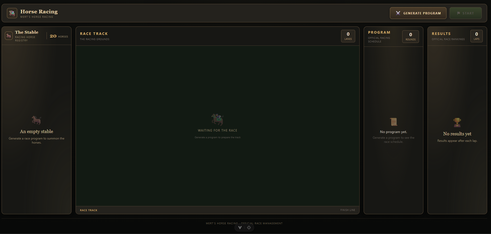
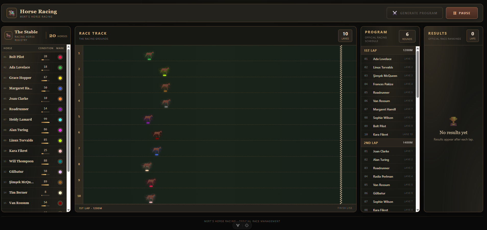
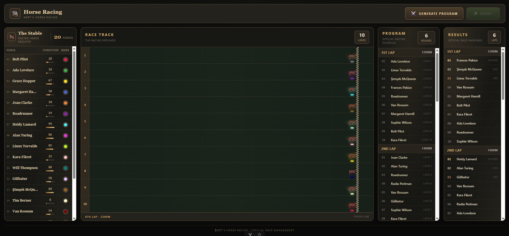
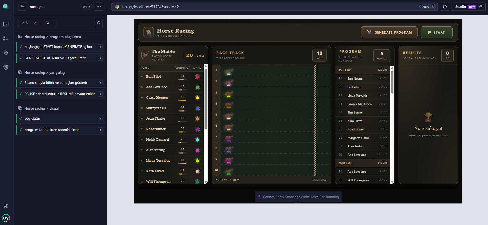

# Horse Racing

Vue 3 ve TypeScript ile geliştirilmiş, tarayıcıda çalışan bir at yarışı simülasyonu. Program
oluşturulduğunda 20 at hazırlanır ve her biri 10 at içeren, farklı mesafelerde 6 yarış turu
oluşturulur. Yarış sırasında atların ilerlemesi ve tur sonuçları ekranda gösterilir.

## Özellikler

- At listesi; her atın adı, rengi ve kondisyon puanı
- 1.200 m ile 2.200 m arasında değişen 6 turluk yarış programı
- Yarışı başlatma, duraklatma ve devam ettirme
- Yarış pisti üzerinde animasyonlu ilerleme
- Her turun bitiş sıralamasını gösteren sonuç paneli
- Aynı `seed` değeriyle tekrarlanabilir at ve yarış üretimi

## Ekran Görüntüleri

### Uygulama







### Testler



## Gereksinimler

- Node.js `22.18+` (22.x) veya `24.12+`
- npm

## Kurulum ve Çalıştırma

```sh
npm ci
npm run dev
```

Vite, geliştirme sunucusunun adresini terminalde gösterir. İsteğe bağlı olarak URL parametreleri
kullanılabilir:

```text
http://localhost:5173/?seed=42&speed=10
```

- `seed`: Pozitif bir sayı verildiğinde rastgele üretimi tekrarlanabilir hale getirir.
- `speed`: Yarış hız çarpanıdır; `1` ile `50` arasındaki değerler kabul edilir. Geçersiz veya
  belirtilmemiş değer `1` olarak kullanılır.

## Testler ve Üretim Derlemesi

Birim testlerini tek seferde çalıştırın:

```sh
npm run test:unit -- --run
```

Cypress'i geliştirme sunucusuna karşı etkileşimli açmak için:

```sh
npm run test:e2e:dev
```

Üretim derlemesini oluşturup Cypress uçtan uca testlerini bu derlemeye karşı çalıştırmak için:

```sh
npm run build
npm run test:e2e
```

`npm run build`, TypeScript/Vue tür denetimini ve üretim derlemesini birlikte çalıştırır.
Cypress testleri yarış akışını ve ekran görüntüsü karşılaştırmalarını kapsar.

## Mimari

- **Pinia:** Atlar, yarış programı ve yarış durumunun yönetimi.
- **Composables:** Yarış döngüsü ve animasyon zamanlaması.
- **Components:** Yarış ekranının bağımsız ve yeniden kullanılabilir bileşenlere ayrılması.
- **Utils:** At üretimi, program oluşturma ve yarış simülasyonu mantığı.
- **TypeScript:** Uygulama genelinde tip güvenliği.

## Proje Yapısı

```text
src/
├── components/   # At listesi, yarış pisti, kontroller, program ve sonuç bileşenleri
├── composables/  # Yarış animasyon döngüsü
├── constants/    # Yarış ve at ayarları
├── stores/       # Pinia at, program ve yarış durumları
├── types/        # TypeScript türleri
├── utils/        # At/program üretimi, yarış simülasyonu ve yardımcılar
└── views/        # Ana yarış ekranı
cypress/
├── e2e/          # Uçtan uca ve görsel testler
└── snapshots/    # Görsel testlerin referans görüntüleri
```

## Kullanılan Teknolojiler

Vue 3, TypeScript, Pinia, Vite, Tailwind CSS, Vitest ve Cypress.

> **Not:** `npm run lint` ve `npm run format` komutları mevcut yapılandırmada otomatik düzeltme
> yapabilir; çalıştırmadan önce dosyalardaki değişiklikleri gözden geçirin.
